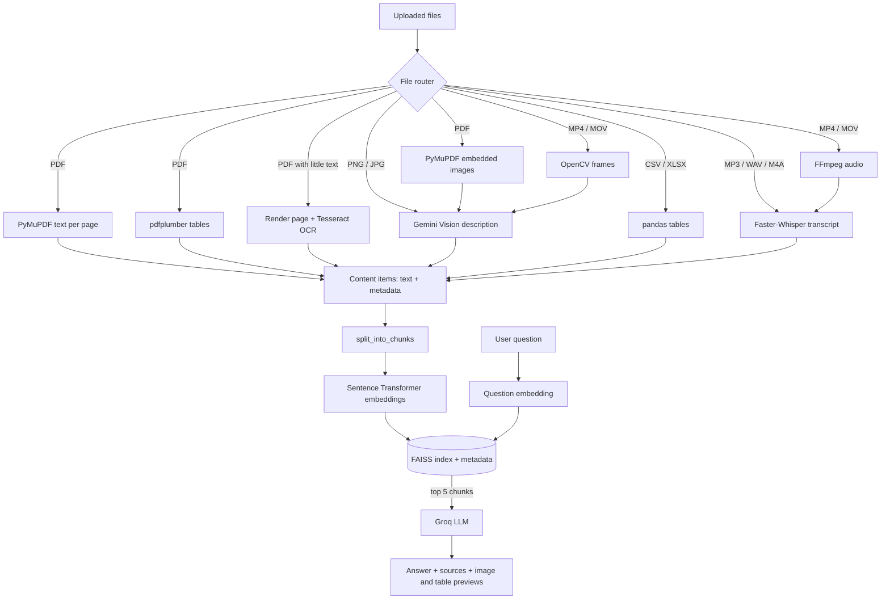

# Multimodal RAG Document Intelligence Assistant

Ask questions about PDFs, scanned documents, images, charts, tables, spreadsheets, audio and video, all through **one** FAISS-based RAG pipeline. The whole app (Streamlit frontend + backend) lives in a single file, `app.py`.

## 1. Project Overview

Your first RAG project handled text from PDF and TXT files. This one answers a bigger question: **how can a single retrieval pipeline work for many kinds of content?**

The answer is simple: convert every modality into *text with metadata*, then run the same chunk, embed, search and answer steps on all of it.

| Content | How it becomes text |
|---|---|
| PDF text | PyMuPDF extracts text page by page |
| Scanned PDF | Page is rendered as an image, then read by Tesseract OCR |
| PDF images, charts, diagrams | Extracted with PyMuPDF, then described by Gemini Vision |
| Uploaded images | Gemini Vision description (Tesseract OCR as fallback) |
| Tables (PDF, CSV, XLSX) | pdfplumber / pandas, written as `col \| col \| col` rows |
| Audio | Faster-Whisper transcript with timestamps |
| Video | Sampled frames described by Gemini + audio track transcribed by Faster-Whisper |

## 2. Project Objectives

- Understand how text, image, table, audio and video content can share one vector index.
- Keep metadata (filename, type, page, table id, timestamp, image reference) attached to every piece of content.
- Answer only from retrieved content, and show which sources were used.
- Keep the code beginner-friendly: simple functions, no classes, no agents.

## 3. Technology Stack

| Area | Tools |
|---|---|
| Frontend | Streamlit |
| PDF | PyMuPDF, pdfplumber |
| Images | Pillow, OpenCV, Gemini Vision (`google-genai`) |
| OCR | Tesseract + pytesseract |
| Tables | pdfplumber, pandas, openpyxl |
| Audio | Faster-Whisper |
| Video | OpenCV, FFmpeg |
| Embeddings | Sentence Transformers `all-MiniLM-L6-v2` |
| Vector database | FAISS (CPU), `IndexFlatIP` with normalized vectors (cosine similarity) |
| LLM | Groq (`openai/gpt-oss-120b` by default, configurable) |

## 4. Architecture



## 5. Multimodal RAG Workflow

1. **Upload** – any mix of supported files.
2. **Extract** – each file type is routed to its own extraction function (`process_file`).
3. **Common text representation** – every result becomes a *content item* (`text` + `source`, `content_type`, `page`, `table_id`, `start`/`end` timestamps, `image_ref`).
4. **Chunk** – `split_into_chunks()` cuts long content into ~800-character pieces with 150 characters of overlap. Tables are split by rows and the header is repeated in every chunk.
5. **Embed** – each chunk (with a short metadata header such as `[report.pdf | PDF table | page 2]`) is embedded with MiniLM.
6. **Store** – normalized vectors go into FAISS `IndexFlatIP`. Vector number *i* matches `chunks[i]`, which holds the metadata.
7. **Retrieve** – the question is embedded the same way and the 5 most similar chunks are returned. Questions that mention "page N" or "N seconds" also pin matching chunks.
8. **Answer** – Groq receives the numbered chunks with their source labels and must answer only from them.
9. **Display** – answer, retrieved context, source list, image previews and table previews.

## 6. Supported Modalities in Detail

- **PDF text** – `extract_pdf_text()` reads each page. Pages with fewer than 30 characters are treated as scanned or image-only.
- **Scanned PDF (OCR)** – `perform_ocr()` renders such pages at 200 DPI and runs Tesseract. Pages that gave good OCR text are not sent to Gemini again.
- **PDF images** – `extract_pdf_images()` pulls embedded images (ignoring icons smaller than 100 px) and asks Gemini to describe them, including visible text, chart values and trends, and diagram relationships. The picture is kept so it can be previewed. At most 15 images per PDF are analysed (`MAX_PDF_IMAGES`).
- **Images** – `process_image()` sends PNG/JPG files to Gemini. If Gemini is unavailable, OCR text is indexed instead and a warning is shown.
- **Tables** – `extract_tables()` uses pdfplumber for PDFs and pandas for CSV/XLSX (every sheet). Headers are preserved and each table is written as readable `col | col | col` rows with an ID such as `report.pdf-p2-t1`.
- **Audio** – `transcribe_audio()` uses Faster-Whisper and groups the transcript into ~30-second windows with start/end times.
- **Video** – `process_video()` samples a frame every `VIDEO_FRAME_INTERVAL` seconds (at most `MAX_VIDEO_FRAMES`, near-identical frames skipped), describes each frame with Gemini, extracts the audio track with FFmpeg and transcribes it.

## 7. Folder Structure

```
Multimodal_RAG_Project/
├── app.py
├── requirements.txt
├── .env
├── .gitignore
└── README.md
```

## 8. Installation

Python 3.10 or newer is recommended.

### 8.1 Virtual environment and Python packages

```bash
python -m venv .venv

# Windows
.venv\Scripts\activate
# macOS / Linux
source .venv/bin/activate

pip install -r requirements.txt
```

### 8.2 Install Tesseract OCR (not installed by pip)

- **Windows:** install from https://github.com/UB-Mannheim/tesseract/wiki, then add the install folder (for example `C:\Program Files\Tesseract-OCR`) to your PATH.
- **macOS:** `brew install tesseract`
- **Ubuntu / Debian:** `sudo apt install tesseract-ocr`

Check it with `tesseract --version`.

### 8.3 Install FFmpeg (not installed by pip)

- **Windows:** `winget install ffmpeg` (or download from https://ffmpeg.org and add it to PATH)
- **macOS:** `brew install ffmpeg`
- **Ubuntu / Debian:** `sudo apt install ffmpeg`

Check it with `ffmpeg -version`.

### 8.4 First-run downloads

On first use the app downloads the embedding model (about 90 MB) and the Whisper model (`base`, about 140 MB). This needs internet access.

The app includes a compatibility fallback for `faster-whisper` with PyAV versions
that do not support the `metadata_errors` argument used by the library's default
decoder. Audio is decoded through PyAV and passed to Whisper as a normalized
waveform when that mismatch occurs.

## 9. API Configuration

Edit `.env`:

```
GROQ_API_KEY=your_groq_api_key
GOOGLE_API_KEY=your_google_gemini_api_key
```

- **Groq key:** create one at https://console.groq.com. It is required for answers.
- **Gemini key:** create one at https://aistudio.google.com. It is needed for image, chart and video-frame understanding. Without it, text, tables, OCR and audio still work.

Optional settings (defaults shown in the `.env` file): `GROQ_MODEL`, `GEMINI_MODEL`, `WHISPER_MODEL`, `VIDEO_FRAME_INTERVAL`, `MAX_VIDEO_FRAMES`, `MAX_PDF_IMAGES`, `MAX_FILE_MB`.

Model names change over time. If you get a "model not found" or "decommissioned" error, check the current names in the Groq and Gemini documentation and update `GROQ_MODEL` or `GEMINI_MODEL`. Keys are never printed or displayed; the sidebar only shows whether each key is set.

## 10. Run the Application

```bash
streamlit run app.py
```

Streamlit's default upload limit is 200 MB per file. To change it:

```bash
streamlit run app.py --server.maxUploadSize 500
```

Then:
1. Choose **Multimodal Document Mode**.
2. Upload files and click **Process Files** (video and audio can take a while on CPU).
3. Ask questions in the chat. Open **Retrieved context** to see exactly what the answer was based on.

**General AI Mode** skips retrieval and sends your question straight to Groq.

## 11. Example Questions

- PDF: "Summarize this document." / "Explain the main concepts on page 5."
- Image: "What does this image represent?" / "Explain the diagram."
- Table: "What is the highest value in the table?" / "Compare the values in the table."
- Chart: "Explain the trend shown in the chart." / "Which category is the highest?"
- Scanned PDF: "What is the total amount on the invoice?"
- Audio: "What are the main points discussed?"
- Video: "What happens at the 30-second timestamp?"
- Combined: "Compare the information in the PDF and the uploaded spreadsheet."

## 12. Known Limitations

**Testing status.** In the environment where this project was built, the following were tested with real libraries and generated sample files: PDF text extraction, embedded image extraction, PDF table extraction, CSV and XLSX processing, scanned-PDF OCR with Tesseract, video frame extraction with OpenCV, audio extraction with FFmpeg, FAISS indexing and retrieval, metadata preservation, error messages, and the Streamlit interface.

**Not tested against the real service** (no network access or API keys were available there): the Gemini Vision API (the request code was exercised with a stand-in client), the Groq API (stand-in client), the real `all-MiniLM-L6-v2` embedding model (a simple stand-in embedder was used), and Faster-Whisper transcription (model download was blocked). These parts follow the official SDK usage, but you should run a first end-to-end test on your own machine with your API keys.

**Design limits:**
- Only the top 5 chunks are retrieved, so "summarize the whole document" only sees the most relevant parts.
- Image and video descriptions are AI-generated and can contain mistakes, especially for approximate chart values.
- Analysis is capped (15 images per PDF, 12 frames per video, 2000 rows per table) to control API cost and time; capped items are reported as warnings.
- PDF table detection works best on tables with visible borders; complex layouts may be missed or split.
- OCR quality depends on scan quality; only English OCR is configured by default.
- Whisper runs on CPU and can be slow for long audio; speech detection depends on audio quality.
- Audio transcription requires a compatible Faster-Whisper/PyAV installation and a successful first-run Whisper model download. The built-in decoder fallback handles the `metadata_errors` incompatibility between Faster-Whisper 1.2.1 and PyAV 19.
- Password-protected PDFs are not supported.
- The index lives in memory and is rebuilt each time you click **Process Files**.
- Free API tiers have rate limits, which can slow down or interrupt image and video analysis.
